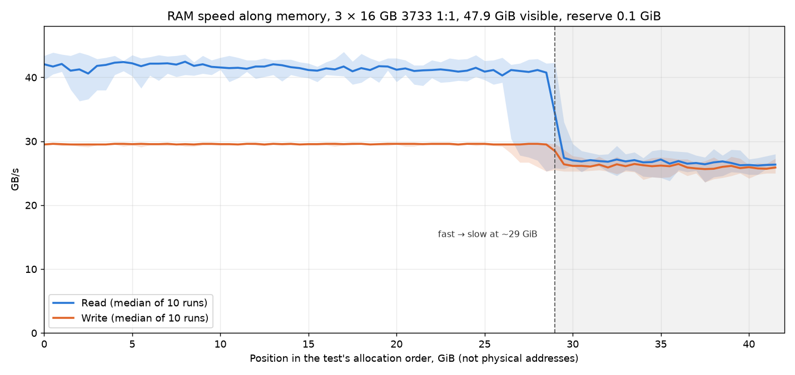
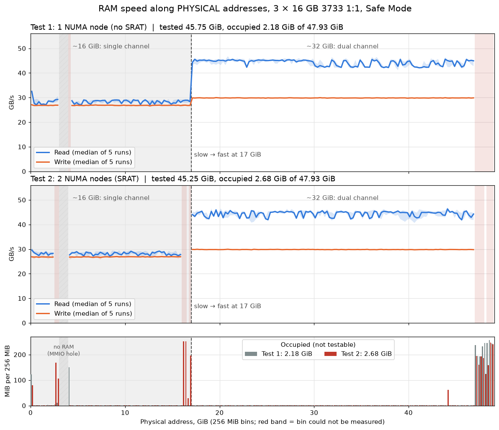
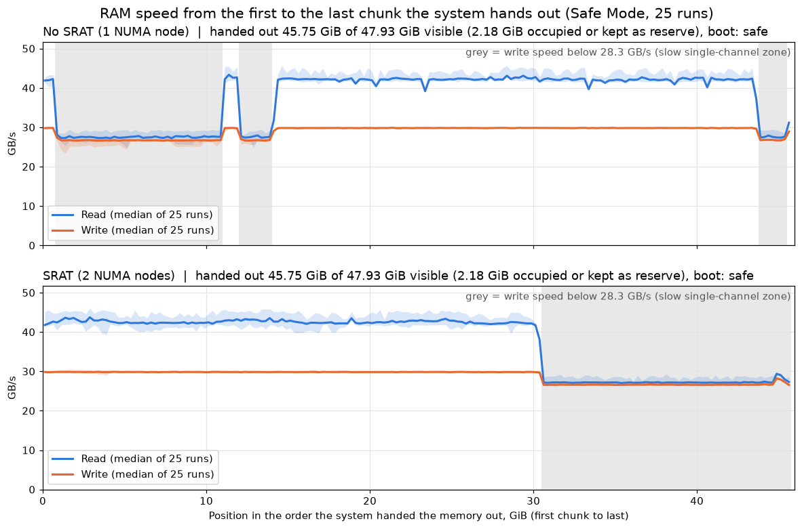
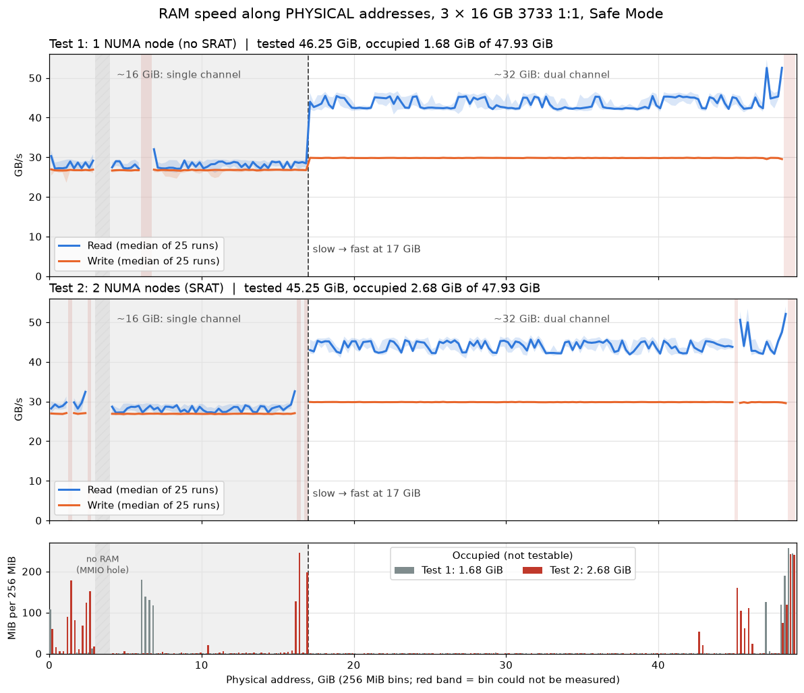

# RAM speed by configuration

Measured 2026-10-17 (A re-measured 2026-10-18 as the baseline: median of 5 fast + 5 deep runs) with `scripts/membench.py` (numpy, 12 threads). Deep sweep = all free RAM minus 2 GiB, in 512 MiB chunks, 3 passes per chunk, best kept. Copy counts read + write bytes.

## Final summary

Deep = median over the whole sweep. % = deep median relative to the baseline A for read / copy.

| # | Sticks | Capacity | MT/s | FCLK | Fast read / write / copy | Deep read / write / copy | % of A (read / copy) | Slow chunks | Verdict |
|---|---|---|---|---|---|---|---|---|---|
| **A (baseline)** | 2 × 16 GB Crucial, 1 per channel | 32 GB | 3733, CL16-20-16-38 1T, tRC 60, tRFC 597 | 1867 (1:1) | 47.1 / 29.6 / 44.8 | **46.9 / 29.6 / 44.4** | 100% / 100% | 0 (1 transient in 1 of 5 runs) | ✅ Baseline, fastest |
| B | 3 × 16 GB, uneven (A: 2, B: 1) | 48 GB | 2133 (XMP off) | not recorded | not run | 25.0 / 16.8 / 17.0 | 53% / 38% | 16 (~8 GiB) | ❌ Worst: low clock + single-channel band |
| C | 4 × 16 GB, 2 per channel | 64 GB | 3600 | 1800 (1:1) | 39.2 / 28.5 / 37.1 | 38.5 / 28.4 / 39.8 | 82% / 90% | 0 | Good, uniform |
| D | 4 × 16 GB, 2 per channel | 64 GB | 3666 | 1800 (not 1:1) | 34.8 / 28.4 / 36.2 | 35.7 / 28.4 / 38.3 | 76% / 86% | 0 | ⚠️ Slower than C: fabric out of sync |
| E | 4 × 16 GB, 2 per channel | 64 GB | 3666 | 1833 (1:1) | 38.3 / 29.1 / 37.5 | 39.1 / 29.0 / 40.1 | 83% / 90% | 0 | ✅ Best 64 GB (needs stability test) |
| F | 2 × 16 GB Crucial, 1 per channel | 32 GB | 3733, CL16-20-16-38 1T | 1867 (1:1) | 45.8 / 29.7 / 44.4 | 45.1 / 29.5 / 43.9 | 96% / 99% | 0 | Same setup as A (single earlier run) |
| G | 4 × 16 GB, 2 per channel | 64 GB | 3666, **CL28-27-27-58** 1T, tRC 88, tRFC 643 | 1833 (1:1) | — | **38.8 / 29.0 / 39.5** (median of 5) | 83% / 89% | 0 | Same as E despite much looser timings |
| H | 3 × 16 GB, uneven (A: 1, B: 2) | 48 GB | 3733, CL16-19-19-39 1T, tRC 88, tRFC 653 | 1867 (1:1) | — | **35.9 / 29.4 / 31.2** (median of 5) | 77% / 70% | 4–16 of ~57 | ⚠️ Far better than B, but still has slow bands; copy is very noisy |
| I | same sticks as H, **OS limited to 30.9 GiB by `truncatememory`** | 48 GB installed, 30.9 GiB visible | 3733, CL16-19-19-39 1T, tRC 88, tRFC 653 | 1867 (1:1) | — | 38.8 / 29.2 / 32.7 (single run, 21.5 GiB tested) | 83% / 74% | 17 of 43 (~8.5 GiB) | ℹ️ Not a fault: `bcdedit /set truncatememory 0x800000000` (32 GiB cap) took effect at the 09:47 reboot |
| J | same sticks as H, **OS limited to 14.9 GiB** (`truncatememory 0x400000000`) | 48 GB installed, 14.9 GiB visible | 3733, CL16-19-19-39 1T, tRC 88, tRFC 653 | 1867 (1:1) | — | **25.7 / 25.0 / 22.1** (median of 10) | 55% / 50% | 0 | ℹ️ Uniform but only ~single-channel speed in the lowest 16 GiB |
| K | same as J (repeat after another reboot) | 14.9 GiB visible | 3733 (WMI; HWiNFO off, FCLK/timings not read) | not read | — | **25.1 / 24.5 / 21.9** (median of 10) | 54% / 49% | 0 | ℹ️ Repeats J within ~2% |
| L | same as J (third boot, HWiNFO on) | 14.9 GiB visible | 3733, CL16-19-19-39 1T, tRC 88, tRFC 653 | 1867 (1:1) | — | **25.3 / 24.4 / 21.6** (median of 10) | 54% / 49% | 0 | ℹ️ Repeats J and K within ~2% |
| M | same sticks as H, **OS sees 32.0 GiB** (reboot 13:03; cap value not confirmed) | 48 GB installed, 32.0 GiB visible | 3733, CL16-19-19-39 1T, tRC 88, tRFC 653 | 1867 (1:1) | — | **36.5 / 29.3 / 38.2** (median of 10; copy is bimodal ~27 / ~38.5) | 78% / 86% | 9–13 of ~47 | ℹ️ Same picture as H: fast bands plus slow bands |
| N | same as M, **BIOS option DRAM Map Inversion: Disabled → Enabled** (32.0 GiB visible) | 48 GB installed, 32.0 GiB visible | 3733, CL16-19-19-39 1T, tRC 88, tRFC 653 | 1867 (1:1) | — | **37.4 / 29.4 / 27.2** (median of 10; copy ~27 in 9 of 10 runs) | 80% / 61% | 13–19 of ~47 | ℹ️ Cleaner map: slow start, long flat fast zone, slow tail |
| O | same sticks as N, **sticks swapped: A has 2, B has 1** (32.0 GiB visible) | 48 GB installed, 32.0 GiB visible | 3733, CL16-19-19-39 1T, tRC 87, tRFC 653 | 1867 (1:1) | — | **38.3 / 29.4 / 27.1** (median of 10) | 82% / 61% | 13–18 of ~47 | ℹ️ Speed unchanged by the swap; copy steady at ~27 in all 10 runs |
| P | same sticks as O, **DRAM Map Inversion: Enabled → Disabled** (32.0 GiB visible) | 48 GB installed, 32.0 GiB visible | 3733, CL16-19-19-39 1T, tRC 87, tRFC 653 | 1867 (1:1) | — | **32.7 / 28.8 / 29.3** (median of 10) | 70% / 66% | 5–11 of ~47 | ⚠️ Read ~15% below O with inversion on; one fast band in the middle, big mid-speed tail |
| Q | same sticks as O, **DRAM Map Inversion: Auto, all 47.9 GiB visible** | 48 GB, 47.9 GiB visible | 3733, CL16-19-19-39 1T, tRC 87, tRFC 653 | 1867 (1:1) | — | **39.6 / 29.6 / 27.8** (median of 10) | 84% / 63% | 13–18 of ~80 | ✅ Best 48 GB result so far: one long fast zone, slow only at both ends |
| R | same sticks as O/Q, **SRAT setting changed** (47.9 GiB visible) | 48 GB, 47.9 GiB visible | 3733 (WMI; HWiNFO off, timings/FCLK not read) | not read | — | **40.9 / 29.6 / 27.1** (median of 10) | 87% / 61% | 26–27 of 78 | ✅ Best read of any 48 GB run; clean two-zone map: fast first ~26 GiB, slow last ~13 GiB |
| S | same as R, extra UI processes closed, **0.1 GiB reserve** (47.9 GiB visible) | 48 GB, 47.9 GiB visible | 3733, CL16-19-19-39 1T, tRC 87, tRFC 653 | 1867 (1:1) | — | **40.8 / 29.5 / 40.6** (median of 10; 2 runs in a ~31 copy mode) | 87% / 91% | 30–31 of 84–90 | ✅ Fast zone grew to ~29 GiB; chart in this file |
| T | same sticks as O/Q/S, **Safe Mode, physical-address map** (`membench_phys.py`), 1 NUMA node (no SRAT patch) | 48 GB, 47.9 GiB visible, 45.75 GiB tested | 3733 (SMBIOS; timings/FCLK not read) | not read | — | **39.1 / 28.8 / 33.5** (size-weighted; median of 5 runs per 256 MiB bin) | 83% / 75% | 0 (two flat zones) | ✅ Fast zone = exactly the top 32 GiB (17–49 GiB phys), slow = lowest ~16 GiB |
| U | same as T, **2 NUMA nodes (SRAT patch)** | 48 GB, 47.9 GiB visible, 45.25 GiB tested | 3733 (SMBIOS; timings/FCLK not read) | not read | — | **39.4 / 28.8 / 33.7** (size-weighted; median of 5 runs per 256 MiB bin) | 84% / 76% | 0 (two flat zones) | ✅ Identical to T within noise: the NUMA split does not change speed |
| V | same sticks, **Safe Mode, no SRAT (1 NUMA node), ordinary memory in system order** (`membench_phys.py`, 25 runs) | 48 GB, 47.9 GiB visible, 45.75 GiB tested | 3733 (SMBIOS; timings/FCLK not read) | not read | — | **41.9 / 29.8 / 39.3** (median of 25 runs) | 89% / 89% | 14.0 of 45.75 GiB | ℹ️ System order: slow first (~10 GiB at the start), then ~30 GiB fast, slow again at the end |
| W | same as V, **SRAT patch (2 NUMA nodes)** | 48 GB, 47.9 GiB visible, 45.75 GiB tested | 3733 (SMBIOS; timings/FCLK not read) | not read | — | **42.1 / 29.8 / 39.3** (median of 25 runs) | 90% / 89% | 15.25 of 45.75 GiB | ✅ System order: fast first (30.5 GiB), then slow (15.25 GiB) as one block at the end |

All values GB/s. Write is ~29 GB/s on every config except B; read and copy are what change.

## VRAM (both GPUs)

Measured 2026-10-19 with `python scripts/membench.py deep --no-ram` (OpenCL): all reported VRAM in 256 MiB chunks, 3 passes per chunk, best kept; **median of 5 runs**. Copy counts read + write bytes.

| GPU | VRAM | Bus / memory | Theoretical peak | Read / write / copy (median of 5) | Run-to-run spread (read / write / copy) | Read / write vs peak | Slow chunks per run |
|---|---|---|---|---|---|---|---|
| AMD Radeon RX 6600 XT (GPU 0) | 8 GB, 30 chunks tested | 128-bit GDDR6, 16 Gbps | 256 GB/s | **217.4 / 243.2 / 203.3** | 0.7% / 1.2% / 1.0% | 85% / 95% | 2, 3, 2, 0, 0 † |
| NVIDIA GeForce GTX 980 (GPU 1) | 4 GB, 14 chunks tested | 256-bit GDDR5, 7 Gbps | 224 GB/s | **167.5 / 166.5 / 160.2** | 0.6% / 1.0% / 0.2% | 75% / 74% | 0, 0, 0, 0, 0 |

Per-chunk range over all 5 runs:

| GPU | Read | Write | Copy |
|---|---|---|---|
| RX 6600 XT | 204.4 – 222.7 | 213.3 – 249.4 | 132.1 – 208.3 † |
| GTX 980 | 160.0 – 168.7 | 158.8 – 168.0 | 156.7 – 160.6 |

† RX 6600 XT: 2–3 chunks per run dipped (copy down to ~132 GB/s) in runs 1–3 and none in runs 4–5, so it isn't a fixed slow region. Most likely contention from whatever else uses that GPU at the same time (e.g. the desktop/display). The medians are unaffected.

- **RX 6600 XT is ~30% faster than the GTX 980** on read (217 vs 168) and ~46% on write (243 vs 167), despite half the bus width: GDDR6 at 16 Gbps vs GDDR5 at 7 Gbps.
- **Both cards are uniform across all their VRAM** and stay within ~1% run to run. Neither showed a slow tail, so all reported VRAM is real on-card memory (no spill into shared system memory).
- The GTX 980 reaches only ~75% of its theoretical peak, typical of Maxwell on a simple streaming kernel; the 6600 XT gets 85–95%.

## Configurations

| # | Sticks | Layout | Total | Speed (configured) | FCLK |
|---|---|---|---|---|---|
| A | 2 × 16 GB Crucial BL16G36C16U4B | dual-channel, 1 per channel (Channel A/B DIMM 1) | 32 GB | **3733**, CL16-20-16-38 1T, tRC 60, tRFC 597 | 1867 = UCLK 1867 (1:1, read via HWiNFO) |
| B | 3 × 16 GB: G.Skill F4-3600C16 + 2 × Crucial BL16G36C16U4B | Channel A: 2 sticks, Channel B: 1 | 48 GB | **2133** (XMP off) | not recorded |
| C | 4 × 16 GB: 2 × G.Skill F4-3600C16 + 2 × Crucial BL16G36C16U4B | 2 per channel, balanced | 64 GB | 3600 | 1800 (1:1) |
| D | same as C | same as C | 64 GB | **3666** (overclocked) | 1800 (**not** 1:1) |
| E | same as C | same as C | 64 GB | 3666 | 1833 (1:1) |
| G | same as C | same as C | 64 GB | 3666, CL28-27-27-58 1T, tRC 88, tRFC 643 (read via HWiNFO) | 1833 = UCLK 1833 (1:1) |
| F | 2 × 16 GB Crucial BL16G36C16U4B | dual-channel, 1 per channel (Channel A/B DIMM 1) | 32 GB | **3733**, CL16-20-16-38 1T | 1867 (1:1, read via HWiNFO) |
| H | 3 × 16 GB: G.Skill F4-3600C16 (Channel B DIMM 0) + 2 × Crucial BL16G36C16U4B (Channel A DIMM 1, Channel B DIMM 1) | Channel A: 1 stick, Channel B: 2 | 48 GB | 3733, CL16-19-19-39 1T, tRC 88, tRFC 653 (read via HWiNFO, 2026-10-26) | 1867 = UCLK 1867 (1:1) |
| I | same as H | same as H | 48 GB installed, **30.9 GiB visible** because of `truncatememory` 0x800000000 (2026-10-26, after reboot at 09:47) | 3733, CL16-19-19-39 1T, tRC 88, tRFC 653 | 1867 = UCLK 1867 (1:1) |
| J | same as H | same as H | 48 GB installed, **14.9 GiB visible** because of `truncatememory` 0x400000000 (16 GiB cap, 2026-10-26, reboot at 09:55) | 3733, CL16-19-19-39 1T, tRC 88, tRFC 653 | 1867 = UCLK 1867 (1:1) |
| K | same as H | same as H | 14.9 GiB visible, same `truncatememory` 0x400000000 (reboot at 12:04) | 3733 per WMI; timings and FCLK not read (HWiNFO not running) | not read |
| L | same as H | same as H | 14.9 GiB visible, same `truncatememory` 0x400000000 (reboot at 12:19) | 3733, CL16-19-19-39 1T, tRC 88, tRFC 653 (read via HWiNFO) | 1867 = UCLK 1867 (1:1) |
| M | same as H | same as H | 48 GB installed, **32.0 GiB visible** (reboot at 13:03; the `truncatememory` value in effect was not checked) | 3733, CL16-19-19-39 1T, tRC 88, tRFC 653 (read via HWiNFO, rerun) | 1867 = UCLK 1867 (1:1) |
| N | same as H | same as H | 32.0 GiB visible (reboot at 13:28), BIOS option DRAM Map Inversion switched Disabled → Enabled | 3733, CL16-19-19-39 1T, tRC 88, tRFC 653 (read via HWiNFO) | 1867 = UCLK 1867 (1:1) |
| O | G.Skill F4-3600C16 (Channel A DIMM 0) + 2 × Crucial BL16G36C16U4B (Channel A DIMM 1, Channel B DIMM 1) | Channel A: 2 sticks, Channel B: 1 (swapped from H–N) | 48 GB installed, 32.0 GiB visible (reboot at 13:54; DRAM Map Inversion left at Enabled, not re-checked) | 3733, CL16-19-19-39 1T, tRC 87, tRFC 653 (read via HWiNFO) | 1867 = UCLK 1867 (1:1) |
| P | same as O | same as O (Channel A: 2 sticks, Channel B: 1) | 32.0 GiB visible (reboot at 14:05), DRAM Map Inversion switched Enabled → Disabled | 3733, CL16-19-19-39 1T, tRC 87, tRFC 653 (read via HWiNFO) | 1867 = UCLK 1867 (1:1) |
| Q | same as O | same as O (Channel A: 2 sticks, Channel B: 1) | 48 GB installed, **47.9 GiB visible** (reboot at 14:14, `truncatememory` apparently removed), DRAM Map Inversion = Auto | 3733, CL16-19-19-39 1T, tRC 87, tRFC 653 (read via HWiNFO) | 1867 = UCLK 1867 (1:1) |
| R | same as O | same as O (Channel A: 2 sticks, Channel B: 1) | 47.9 GiB visible (reboot at 17:15), SRAT setting changed (exact option name/value not recorded) | 3733 per WMI; timings and FCLK not read (HWiNFO not running) | not read |
| S | same as O | same as O (Channel A: 2 sticks, Channel B: 1) | 47.9 GiB visible, 42–45 GiB free before each run, reserve 0.1 GiB (`SearchApp` and `RadeonSoftware` closed) | 3733, CL16-19-19-39 1T, tRC 87, tRFC 653 (read via HWiNFO) | 1867 = UCLK 1867 (1:1) |

## Results (GB/s)

| | A | B | C | D | E | F | G | H | I | J | K | L | M | N | O | P | Q | R | S |
|---|---|---|---|---|---|---|---|---|---|---|---|---|---|---|---|---|---|---|---|
| Fast test, 1 GiB (read / write / copy) | 47.1 / 29.6 / 44.8 (median of 5) | not run | 39.2 / 28.5 / 37.1 | 34.8 / 28.4 / 36.2 | 38.3 / 29.1 / 37.5 | 45.8 / 29.7 / 44.4 | not run | not run | not run | not run | not run | not run | not run | not run | not run | not run | not run | not run | not run |
| Deep: tested | 22.0 GiB, 44 chunks, × 5 runs | 37.0 GiB, 74 chunks | 54.0 GiB, 108 chunks | 54.5 GiB, 109 chunks | 54.5 GiB, 109 chunks | 21.5 GiB, 43 chunks | 54.5–56.0 GiB, × 5 runs | 28.0–28.5 GiB, × 5 runs | 21.5 GiB, 43 chunks, 1 run | 7.5–8.0 GiB, × 10 runs | 7.0–7.5 GiB, × 10 runs | 7.0–8.0 GiB, × 10 runs | 23.5–24.0 GiB, × 10 runs | 23.0–23.5 GiB, × 10 runs | 22.5–23.5 GiB, × 10 runs | 22.0–23.5 GiB, × 10 runs | 38.5–40.0 GiB, × 10 runs | 38.5–39.0 GiB, × 10 runs | 42.0–45.2 GiB (84–90 chunks), × 10 runs |
| Deep: time | 12–13 s per run | 36 s | 28 s | 32 s | 31 s | 11 s | 29–32 s per run | 16–17 s per run | 14 s | 7 s per run | 7 s per run | 7 s per run | 13–15 s per run | 14–16 s per run | 15 s per run | 14–15 s per run | 24–27 s per run | 28–29 s per run | not recorded |
| Deep median read | **46.9** (runs: 45.9–47.3) | 25.0 | 38.5 | 35.7 | 39.1 | **45.1** | 38.8 (runs: 38.4–38.9) | **35.9** (runs: 35.6–37.8) | 38.8 (single run) | **25.7** (runs: 24.0–25.8) | 25.1 (23.1–25.7) | 25.3 (23.7–25.7) | **36.5** (35.2–37.1) | **37.4** (35.4–39.8) | **38.3** (36.9–39.2) | **32.7** (32.2–33.5) | **39.6** (38.6–40.1) | **40.9** (40.2–41.3) | **40.8** (40.3–41.1) |
| Deep median write | 29.6 (29.5–29.7) | 16.8 | 28.4 | 28.4 | 29.0 | 29.5 | 29.0 (29.0–29.1) | 29.4 (29.3–29.5) | 29.2 | 25.0 (22.7–25.2) | 24.5 (22.3–24.8) | 24.4 (22.5–24.6) | 29.3 (29.2–29.4) | 29.4 (28.8–29.4) | 29.4 (29.0–29.5) | 28.8 (28.6–28.9) | 29.6 (29.4–29.6) | 29.6 (29.5–29.6) | 29.5 (29.4–29.5) |
| Deep median copy | **44.4** (44.1–44.6) | 17.0 | 39.8 | 38.3 | 40.1 | **43.9** | 39.5 (39.5–40.1) | **31.2** (runs: 30.8–37.4) | 32.7 | 22.1 (21.3–22.1) | 21.9 (21.0–22.0) | 21.6 (21.3–21.7) | **38.2** (27.1–38.5, two modes) | 27.2 (26.6–38.8) | 27.1 (26.6–27.8) | 29.3 (26.1–35.4) | 27.8 (27.0–28.3) | 27.1 (26.9–27.4) | **40.6** (30.9–41.2, two modes) |
| Read min – max | 44.3 – 48.9 † | 13.9 – 28.0 | 35.4 – 40.5 | 33.2 – 38.4 | 36.0 – 41.0 | 40.3 – 47.0 | 35.0 – 41.9 | 24.9 – 41.8 | 23.0 – 42.1 | 22.6 – 26.6 | 21.9 – 26.4 | 23.2 – 26.3 | 25.1 – 41.2 | 22.6 – 42.7 | 23.3 – 42.3 | 23.2 – 42.0 | 22.6 – 42.8 | 24.2 – 43.4 | 23.6 – 44.0 |
| Write min – max | 29.2 – 29.9 | 13.4 – 17.0 | 28.2 – 28.6 | 28.0 – 28.6 | 28.8 – 29.2 | 28.2 – 29.8 | 28.3 – 29.2 | 24.1 – 29.8 | 21.4 – 29.6 | 22.1 – 25.8 | 20.3 – 25.4 | 21.7 – 25.5 | 24.1 – 29.8 | 21.9 – 29.8 | 22.4 – 29.7 | 22.8 – 29.8 | 22.3 – 29.8 | 23.8 – 29.8 | 23.6 – 29.8 |
| Copy min – max | 42.0 – 45.1 | 13.3 – 17.4 | 35.7 – 40.8 | 34.9 – 39.9 | 36.3 – 41.2 | 42.5 – 44.4 | 35.6 – 41.6 | 24.8 – 39.2 | 24.6 – 33.8 | 20.8 – 22.5 | 20.8 – 22.3 | 21.1 – 22.1 | 22.1 – 40.1 | 21.5 – 40.1 | 21.5 – 28.6 | 21.7 – 38.9 | 21.2 – 29.9 | 21.6 – 29.0 | not recorded |
| Spread (read / write / copy) | run-to-run 3.0% / 0.7% / 1.1% | 56.6% / 21.6% / 24.4% | 13.1% / 1.6% / 12.8% | 14.5% / 2.1% / 13.0% | 12.7% / 1.4% / 12.2% | 15.0% / 5.4% / 4.3% | run-to-run 1.3% / 0.3% / 1.5% | run-to-run 6.1% / 0.7% / 21.2% | within one run: 49.1% / 28.1% / 28.0% | run-to-run 7.0% / 10.0% / 3.6% | 10.4% / 10.2% / 4.6% | 7.9% / 8.6% / 1.9% | 5.2% / 0.7% / 29.8% | 11.8% / 2.0% / 44.9% | 6.0% / 1.7% / 4.4% | 4.0% / 1.0% / 31.7% | 3.8% / 0.7% / 4.7% | 2.7% / 0.3% / 1.8% | 2.0% / 0.3% / 25.0% |
| Slow chunks (< 85% of median) | 0 † | 16 (~8 GiB) | 0 | 0 | 0 | 0 | 0 | 16, 9, 8, 7, 4 per run | 17 of 43 | 0 | 0 | 0 | 11, 11, 11, 11, 11, 13, 9, 10, 10, 11 per run | 19, 18, 17, 15, 16, 13, 15, 14, 14, 13 per run | 16, 17, 16, 18, 17, 17, 16, 14, 13, 14 per run | 11, 10, 9, 7, 6, 5, 8, 7, 6, 5 per run | 17, 17, 18, 17, 16, 15, 15, 13, 14, 14 per run | 27, 27, 26, 26, 26, 26, 26, 26, 26, 26 per run | 31, 30, 30, 31, 31, 30, 31, 30, 30, 31 per run |

† A, run 5: one chunk read 34.7 GB/s (a one-off, likely background activity); the other 4 runs had none and read never dropped below 44.3 there.

Relative to baseline A (median read / write / copy): **B ≈ 53% / 57% / 38%**, **C ≈ 82% / 96% / 90%**, **D ≈ 76% / 96% / 86%**, **E ≈ 83% / 98% / 90%**, **F ≈ 96% / 100% / 99%**, **G ≈ 83% / 98% / 89%**, **H ≈ 77% / 99% / 70%**, **I ≈ 83% / 99% / 74%**, **J ≈ 55% / 84% / 50%**, **K ≈ 54% / 83% / 49%**, **L ≈ 54% / 82% / 49%**, **M ≈ 78% / 99% / 86%**, **N ≈ 80% / 99% / 61%**, **O ≈ 82% / 99% / 61%**, **P ≈ 70% / 97% / 66%**, **Q ≈ 84% / 100% / 63%**, **R ≈ 87% / 100% / 61%**, **S ≈ 87% / 100% / 91%** (S's copy median is in the high mode; the two low-mode runs were ~31 = 70%).

I–L were measured with a `truncatememory` cap (see their sections); column I is a single run, the others are medians of 10. M's copy median sits between two modes (~27 and ~38).

## Per-region view

| Config | Region | Read | Write | Copy |
|---|---|---|---|---|
| A | whole 22 GiB, 5 runs (per-run chunk ranges) | 44.3 – 48.9 † | 29.2 – 29.9 | 42.0 – 45.1 |
| B | 0 – 4 GiB (chunks 0–7) | 13.9 – 15.5 | 13.4 – 14.6 | 13.3 – 13.6 ⚠️ |
| B | 4 – 33 GiB (chunks 8–65) | 21.7 – 28.0 | 16.4 – 17.0 | 16.2 – 17.4 |
| B | 33 – 37 GiB (chunks 66–73) | 14.6 – 19.5 | 14.1 – 16.6 | 13.5 – 15.9 ⚠️ |
| C | 0 – 20.5 GiB (chunks 0–40) | 35.4 – 39.8 | 28.2 – 28.5 | 36.0 – 37.4 |
| C | 20.5 – 51 GiB (chunks 41–101) | 37.4 – 40.5 | 28.3 – 28.6 | 39.2 – 40.8 |
| C | 51 – 54 GiB (chunks 102–107) | 35.9 – 38.7 | 28.3 – 28.5 | 35.7 – 38.0 |
| D | 0 – 21 GiB (chunks 0–42) | 33.2 – 36.7 | 28.0 – 28.5 | 34.9 – 36.7 |
| D | 21.5 – 51.5 GiB (chunks 43–103) | 34.6 – 38.4 | 28.3 – 28.6 | 37.9 – 39.9 |
| D | 52 – 54 GiB (chunks 104–108) | 34.1 – 35.4 | 28.2 – 28.3 | 35.3 – 35.8 |
| E | 0 – 20.5 GiB (chunks 0–41) | 36.0 – 39.9 | 28.8 – 29.1 | 36.3 – 37.4 |
| E | 21 – 52 GiB (chunks 42–104) | 37.0 – 41.0 | 28.8 – 29.2 | 36.8 – 41.2 |
| E | 52.5 – 54 GiB (chunks 105–108) | 37.7 – 39.5 | 28.9 – 29.0 | 36.8 – 38.0 |
| F | 0 – 10 GiB (chunks 0–19) | 42.9 – 47.0 | 29.4 – 29.8 | 43.1 – 44.4 |
| F | 10 – 21 GiB (chunks 20–42) | 40.3 – 46.3 | 28.2 – 29.7 | 42.5 – 44.4 |
| H | 0 – 22.5 GiB (45 chunks) | 37.0 (28.8 – 40.6) | 29.4 | 32.8 |
| H | 22.5 – 24 GiB (3 chunks) ⚠️ | 25.9 (25.4 – 26.0) | 24.7 | 26.7 |
| H | 24 – 28.5 GiB (9 chunks) | 31.3 (31.1 – 32.6) | 28.6 | 29.8 |
| M | 0 – 3 GiB | 28.6 (28.0 – 29.7) | 26.9 | 34.2 |
| M | 3 – 17.5 GiB | 35.3 (30.6 – 39.0) | 29.1 | 37.9 |
| M | 17.5 – 19.5 GiB | 40.3 (39.5 – 40.9) | 29.6 | 39.6 |
| M | 19.5 – 20.5 GiB ⚠️ | 27.9 (27.6 – 28.1) | 26.9 | 33.8 |
| M | 20.5 – 23.5 GiB | 40.1 (39.5 – 41.0) | 29.6 | 39.8 |
| N | 0 – 5 GiB | 27.4 (26.6 – 27.8) | 26.2 | 23.6 |
| N | 5 – 22.5 GiB | 38.6 (30.3 – 39.5) | 29.5 | 27.4 |
| N | 22.5 – 23.5 GiB ⚠️ | 25.6 (25.5 – 25.7) | 25.0 | 22.1 |
| O | 0 – 4 GiB | 30.0 (28.7 – 31.1) | 27.5 | 25.1 |
| O | 4 – 20.5 GiB | 38.9 (36.6 – 39.8) | 29.5 | 27.5 |
| O | 20.5 – 23.5 GiB ⚠️ | 25.5 (25.3 – 25.6) | 24.4 | 22.0 |
| P | 0 – 5 GiB | 32.8 (30.4 – 36.2) | 28.5 | 29.4 |
| P | 5 – 13 GiB | 40.8 (39.7 – 41.2) | 29.6 | 32.4 |
| P | 13 – 16 GiB ⚠️ | 26.1 (25.9 – 28.7) | 25.2 | 25.3 |
| P | 16 – 17 GiB | 40.5 (39.8 – 41.3) | 29.6 | 32.5 |
| P | 17 – 23.5 GiB | 30.2 (29.4 – 30.9) | 27.8 | 28.2 |
| Q | 0 – 3 GiB | 29.6 (28.7 – 30.6) | 27.4 | 25.1 |
| Q | 3 – 36.5 GiB (67 chunks) | 39.2 (37.8 – 40.4) | 29.6 | 28.3 |
| Q | 36.5 – 40 GiB (7 chunks) ⚠️ | 26.0 (25.9 – 29.4) | 25.0 | 22.3 |
| R | 0 – 26 GiB (52 chunks) | 41.5 (37.7 – 43.1) | 29.6 | 28.4 |
| R | 26 – 39 GiB (26 chunks) ⚠️ | 26.1 (25.8 – 26.4) | 25.6 | 22.3 |
| S | 0 – 29 GiB (58 chunks) | 41.5 (40.3 – 42.5) | 29.6 | 40.7 |
| S | 29 – 41.5 GiB (26 chunks) ⚠️ | 26.8 (26.2 – 34.2) | 26.1 | 32.7 |

Offsets are positions in the test's allocation order, not physical addresses. Rows A–F show min – max over chunks; rows H onward show the zone median with the read min – max in brackets (per-chunk medians over 5 runs, zones as in each config's speed map). I, J, K and L are uniform (single region), see their sections.

## Speed map, config H

Per-chunk medians over 5 deep runs (HWiNFO attached), by position in the test's allocation order (not physical addresses). Each cell below is 0.5 GiB: █ ≥ 90% of the fastest chunk (40.6 GB/s read), ▓ 80–90%, ▒ 70–80%, ░ < 70%.

```
0 GiB                                                     28.5 GiB
█▓▓▓▓█████████▓▓▓▓▒███▓██▓▓▓███████▓▓▓▓▓█▓▓██░░░▒▒▓▒▒▒▒▒▒
                                              ^^^ 22.5–24 GiB: slowest
```

| Zone | Where | Chunks | Read | Write | Copy | Read range |
|---|---|---|---|---|---|---|
| 🟢 Fast | 0 – 22.5 GiB | 45 | 37.0 | 29.4 | 32.8 | 28.8 – 40.6 |
| 🔴 Slowest | 22.5 – 24 GiB | 3 | 25.9 | 24.7 | 26.7 | 25.4 – 26.0 |
| 🟠 Slow | 24 – 28.5 GiB | 9 | 31.3 | 28.6 | 29.8 | 31.1 – 32.6 |

- **Fast (🟢)**: first ~22 GiB, read 35–40 GB/s, write ~29.4, copy ~33. The ▓ dips inside are 1–3 GB/s ripples, not a different region.
- **Slowest (🔴)**: a narrow band at 22.5–24 GiB, about 3 chunks (1.5 GiB): read 26, write 24.7, copy 27, i.e. ~35% below the fast zone.
- **Slow (🟠)**: the tail from 24 GiB to the end, read ~31 (−15%), write 28.6 (−3%), copy ~30 (−9%).
- Write suffers least; read suffers most. Single runs also show short-lived dips elsewhere (e.g. around 16–17 GiB in some runs) that average out in the medians, so they're background activity, not a fixed region.

## Visible memory, config I

After the 09:47 reboot on 2026-10-26 the OS reports **30.94 GiB** total (23.6 GiB free) while WMI still lists all three 16 GiB sticks at 3733 MT/s (48 GiB). Earlier H runs saw 47.9 GiB. The cause is a boot setting the user had applied before the reboot: `bcdedit /set truncatememory 0x800000000`, which makes Windows ignore all physical memory above address 32 GiB (the PCI hole below 4 GiB and other reserved ranges account for the rest). It is not a hardware fault. To get all 48 GiB back, run in an admin shell `bcdedit /deletevalue truncatememory` and reboot.

Single deep run on the visible memory (43 × 512 MiB = 21.5 GiB tested, 14 s): median read / write / copy **38.8 / 29.2 / 32.7** GB/s, chunk ranges read 23.0 – 42.1, write 21.4 – 29.6, copy 24.6 – 33.8, 17 chunks (~8.5 GiB) below 85% of the median. Speed is in line with H's fast zone and slow bands, so the sticks that are mapped behave as before.

Because the cap is on physical addresses, this run only exercises the lowest 32 GiB of the address space; the stick(s) mapped above that are not tested in config I.

## Speed under a 16 GiB cap, config J

`bcdedit /set truncatememory 0x400000000` (16 GiB physical-address cap; OS sees 14.94 GiB after the 09:55 reboot). **10 deep runs**, 7.5–8.0 GiB tested per run (free memory is small, 2 GiB is left free), 7 s each. Median of 10 runs, GB/s:

| | Read | Write | Copy |
|---|---|---|---|
| Median of 10 | **25.7** | **25.0** | **22.1** |
| Runs (min – max of per-run medians) | 24.0 – 25.8 | 22.7 – 25.2 | 21.3 – 22.1 |
| Chunk min – max | 22.6 – 26.6 | 22.1 – 25.8 | 20.8 – 22.5 |
| Run-to-run spread | 7.0% | 10.0% | 3.6% |
| vs A | 55% | 84% | 50% |
| vs H fast zone (37.0 / 29.4 / 32.8) | 69% | 85% | 67% |

- **Uniform**: no chunk below 85% of the median in any run, no slow bands. But the whole region is slow, at about what a single DDR4-3733 channel gives (~25 GB/s), against 37 GB/s read in H's fast zone. With the 32 GiB cap (config I) the same sticks gave 38.8 read.
- Runs 1–3 are a little lower (read 24.0–24.7, write 22.7–24.2); runs 4–10 are stable at 25.4–25.8 read, 24.6–25.2 write, 22.0–22.1 copy. Likely start-up background activity.
- So limiting the OS to the lowest 16 GiB of physical addresses leaves it on a region that doesn't get dual-channel interleave on this 1 + 2 layout, or on less than the full set of channels. Treat this as a measurement of that region, not as a fault: nothing is wrong with the sticks. Remove the cap with `bcdedit /deletevalue truncatememory` (admin shell) and reboot.

**Repeat (config K, reboot at 12:04, same cap, HWiNFO not running so FCLK/timings unread):** 10 more runs, 7.0–7.5 GiB tested, 7 s each. Median **25.1 / 24.5 / 21.9** GB/s (runs: read 23.1 – 25.7, write 22.3 – 24.8, copy 21.0 – 22.0; chunk range read 21.9 – 26.4, write 20.3 – 25.4, copy 20.8 – 22.3; run-to-run 10.4% / 10.2% / 4.6%), no slow chunks. That is −2.3% read, −2.0% write, −0.9% copy against J, inside the run-to-run noise (runs 1–2 are again the lowest, 23.1–23.5 read, then it settles at 24.8–25.7). The ~25 GB/s level at a 16 GiB cap is repeatable across two boots.

**Third run (config L, reboot at 12:19, same cap, HWiNFO on):** 10 runs, 7.0–8.0 GiB tested, 7 s each. Median **25.3 / 24.4 / 21.6** GB/s (runs: read 23.7 – 25.7, write 22.5 – 24.6, copy 21.3 – 21.7; chunk range read 23.2 – 26.3, write 21.7 – 25.5, copy 21.1 – 22.1; run-to-run 7.9% / 8.6% / 1.9%), no slow chunks. Against J: −1.6% / −2.4% / −2.3%; against K: +0.8% / −0.4% / −1.4%. All three 10-run sets (J, K, L) sit within 2.5% of each other, with the same pattern of run 1 (and sometimes run 2) being lowest, so the 16 GiB-cap level of ~25 GB/s read, ~24.5 write, ~22 copy is stable. Timings and FCLK are the same as H (CL16-19-19-39, tRC 88, tRFC 653, FCLK 1867).

**Config M (reboot at 13:03, OS sees 32.0 GiB, HWiNFO on in the rerun):** 10 runs, 23.5–24.0 GiB tested, 13–15 s each. Median **36.5 / 29.3 / 38.2** GB/s (an earlier 10-run set with HWiNFO off gave 35.2 / 29.1 / 33.5). Runs: read 35.2 – 37.1, write 29.2 – 29.4, copy 27.1 – 38.5; chunk range read 25.1 – 41.2, write 24.1 – 29.8, copy 22.1 – 40.1; run-to-run 5.2% / 0.7% / 29.8%. Slow chunks per run: 11, 11, 11, 11, 11, 13, 9, 10, 10, 11.

- **Copy is bimodal in time**: runs 1–6 at 38.2–38.5, runs 7–10 at 27.1–27.3 (chunk copy 22–28 instead of 31–40). It flips between blocks of runs, not randomly, and read/write don't follow it, so the 38.2 median just reflects that 6 of 10 runs were in the high mode. Report copy as ~27 or ~38 depending on the mode.

## Speed map, config M

Per-chunk medians over 5 deep runs (47 chunks × 0.5 GiB; █ ≥ 90% of the fastest chunk 41.0 GB/s read, ▓ 80–90%, ▒ 70–80%, ░ < 70%):

```
0 GiB                                          23.5 GiB
░▒▒░░▒▒▓▓█▒▓██▓██▓▓▓▓▓▓▓▓▓▓▒▒▒▒▓▓▓▓████░░██████
```

| Zone | Where | Chunks | Read | Write | Copy | Read range |
|---|---|---|---|---|---|---|
| 🔴 Slow start | 0 – 3 GiB | 6 | 28.6 | 26.9 | 34.2 | 28.0 – 29.7 |
| 🟡 Middle | 3 – 17.5 GiB | 29 | 35.3 | 29.1 | 37.9 | 30.6 – 39.0 |
| 🟢 Fast | 17.5 – 19.5 GiB | 4 | 40.3 | 29.6 | 39.6 | 39.5 – 40.9 |
| 🔴 Slow dip | 19.5 – 20.5 GiB | 2 | 27.9 | 26.9 | 33.8 | 27.6 – 28.1 |
| 🟢 Fast tail | 20.5 – 23.5 GiB | 6 | 40.1 | 29.6 | 39.8 | 39.5 – 41.0 |

- Fast regions (read ~40–41) are at 17.5–19.5 GiB and from 20.5 GiB to the end of the tested range.
- Slow regions: the first ~3 GiB (read 28–30, write 27) and a 1 GiB dip at 19.5–20.5 GiB (read ~28, write 27).
- The middle (3–17.5 GiB) is in between at read 31–39 with a shallower dip near 14–15 GiB (read ~31).
- Positions are the test's allocation order, not physical addresses.

## Config N: DRAM Map Inversion Disabled → Enabled

Boot at 13:28 on 2026-10-26; the BIOS option DRAM Map Inversion was changed from Disabled to Enabled (config M was measured with it disabled). Same visible memory (32.0 GiB), same 3733 CL16-19-19-39 1T, tRC 88, tRFC 653, FCLK = UCLK 1867. 10 deep runs, 23.0–23.5 GiB tested, 14–16 s each.

| GB/s | Read | Write | Copy |
|---|---|---|---|
| **N, median of 10** | **37.4** | **29.4** | **27.2** (9 of 10 runs; one run 38.8) |
| M (option off), median of 10 | 36.5 | 29.3 | 38.2 (bimodal 27 / 38.5) |
| Runs | 35.4 – 39.8 | 28.8 – 29.4 | 26.6 – 38.8 |
| Chunk range | 22.6 – 42.7 | 21.9 – 29.8 | 21.5 – 40.1 |
| Run-to-run spread | 11.8% | 2.0% | 44.9% |

Slow chunks per run: 19, 18, 17, 15, 16, 13, 15, 14, 14, 13 (falling over the first runs).

- Read +2.6% and write ±0 versus M: no real change in those two. Copy mostly sits in M's lower mode (~27); the high mode (~38) appeared in only 1 run of 10 instead of 6 of 10 in M, so with DRAM Map Inversion on, copy is more often in the slow mode. One 10-run set each is not enough to call that an effect of the setting.
- **The speed map is cleaner than M's** (per-chunk medians over 5 runs, 47 chunks × 0.5 GiB; █ ≥ 90% of the fastest chunk 39.5, ▓ 80–90%, ▒ 70–80%, ░ < 70%):

```
0 GiB                                          23.5 GiB
░░░░▒░░░░░██████████████████████████████████▒░░
```

| Zone | Where | Chunks | Read | Write | Copy | Read range |
|---|---|---|---|---|---|---|
| 🔴 Slow start | 0 – 5 GiB | 10 | 27.4 | 26.2 | 23.6 | 26.6 – 27.8 |
| 🟢 Fast | 5 – 22.5 GiB | 35 | 38.6 | 29.5 | 27.4 | 30.3 – 39.5 |
| 🔴 Slow tail | 22.5 – 23.5 GiB | 2 | 25.6 | 25.0 | 22.1 | 25.5 – 25.7 |

A slow start (read ~27–28), then one long flat fast zone from ~5 GiB to ~22.5 GiB (read 38–40), then a slow tail of the last 1 GiB (read ~26, one transition chunk of ~30 just before it). M's map had a ragged middle with dips; here it is three clear zones.

## Config O: sticks swapped between channels

Boot at 13:54 on 2026-10-26. The sticks were moved: before (H–N) Channel A had one Crucial and Channel B had the G.Skill plus a Crucial; now Channel A has the G.Skill (DIMM 0) and a Crucial (DIMM 1), and Channel B has one Crucial (DIMM 1). DRAM Map Inversion was presumably left at Enabled (not re-checked). Same clocks and timings (tRC reads 87 instead of 88). 10 deep runs, 22.5–23.5 GiB tested, 15 s each.

| GB/s | Read | Write | Copy |
|---|---|---|---|
| **O, median of 10** | **38.3** | **29.4** | **27.1** |
| N (before the swap), median of 10 | 37.4 | 29.4 | 27.2 |
| Runs | 36.9 – 39.2 | 29.0 – 29.5 | 26.6 – 27.8 |
| Chunk range | 23.3 – 42.3 | 22.4 – 29.7 | 21.5 – 28.6 |
| Run-to-run spread | 6.0% | 1.7% | 4.4% |

Slow chunks per run: 16, 17, 16, 18, 17, 17, 16, 14, 13, 14.

- Versus N: read +2.4%, write ±0, copy −0.4%, all inside the noise, so the swap itself changed nothing measurable in the totals. Copy is flat at 27 in every run (no 38 mode, unlike M).
- **Speed map** (per-chunk medians over 5 runs, 47 chunks × 0.5 GiB; █ ≥ 90% of the fastest chunk 39.8, ▓ 80–90%, ▒ 70–80%, ░ < 70%):

```
0 GiB                                          23.5 GiB
▒▒▒▒▒▒▒▒█████████████████████████████████░░░░░░
```

| Zone | Where | Chunks | Read | Write | Copy | Read range |
|---|---|---|---|---|---|---|
| 🟡 Slow start | 0 – 4 GiB | 8 | 30.0 | 27.5 | 25.1 | 28.7 – 31.1 |
| 🟢 Fast | 4 – 20.5 GiB | 33 | 38.9 | 29.5 | 27.5 | 36.6 – 39.8 |
| 🔴 Slow tail | 20.5 – 23.5 GiB | 6 | 25.5 | 24.4 | 22.0 | 25.3 – 25.6 |

The shape is the same as N: slower start, long flat fast zone, slow tail. The start is a little faster (read ~30 vs ~27) and the tail a little longer (about 3 GiB at ~26 vs ~1 GiB), so the swap moved some capacity from the start to the end rather than removing the slow areas.

## Config P: DRAM Map Inversion Enabled → Disabled (same sticks as O)

Boot at 14:05 on 2026-10-26; the sticks stay as in O (Channel A: G.Skill + Crucial, Channel B: one Crucial), only DRAM Map Inversion was switched from Enabled back to Disabled. Same clocks and timings. 10 deep runs, 22.0–23.5 GiB tested, 14–15 s each.

| GB/s | Read | Write | Copy |
|---|---|---|---|
| **P (inversion Disabled), median of 10** | **32.7** | **28.8** | **29.3** |
| O (inversion Enabled), median of 10 | 38.3 | 29.4 | 27.1 |
| Runs | 32.2 – 33.5 | 28.6 – 28.9 | 26.1 – 35.4 |
| Chunk range | 23.2 – 42.0 | 22.8 – 29.8 | 21.7 – 38.9 |
| Run-to-run spread | 4.0% | 1.0% | 31.7% |

Slow chunks per run: 11, 10, 9, 7, 6, 5, 8, 7, 6, 5.

- Versus O: read −14.6%, write −2.2%, copy +8% (but copy is noisy again: 26–35 between runs). So with this stick layout, Disabled is clearly worse on read, even though its fast bands are as fast as O's (~41 GB/s); what changes is how much of the memory is in a fast band.
- **Speed map** (per-chunk medians over 5 runs, 47 chunks × 0.5 GiB; █ ≥ 90% of the fastest chunk 41.3, ▓ 80–90%, ▒ 70–80%, ░ < 70%):

```
0 GiB                                          23.5 GiB
▒▒▒▒▒▒▒▒▒▓████████████████░░░░░░██▒▒▒▒▒▒▒▒▒▒▒▒▒
```

| Zone | Where | Chunks | Read | Write | Copy | Read range |
|---|---|---|---|---|---|---|
| 🟡 Mid start | 0 – 5 GiB | 10 | 32.8 | 28.5 | 29.4 | 30.4 – 36.2 |
| 🟢 Fast | 5 – 13 GiB | 16 | 40.8 | 29.6 | 32.4 | 39.7 – 41.2 |
| 🔴 Slow dip | 13 – 16 GiB | 6 | 26.1 | 25.2 | 25.3 | 25.9 – 28.7 |
| 🟢 Fast island | 16 – 17 GiB | 2 | 40.5 | 29.6 | 32.5 | 39.8 – 41.3 |
| 🟡 Mid tail | 17 – 23.5 GiB | 13 | 30.2 | 27.8 | 28.2 | 29.4 – 30.9 |

Only about 9 GiB of the tested 23.5 GiB is in a fast band (5–13 GiB, plus a 1 GiB island at 16–17 GiB); 13–16 GiB is the slow dip (read ~26), and both the start and the 17–23.5 GiB tail sit at read ~30–33. In O (Enabled) a 16.5 GiB band was fast and only the ends were slow, so for this layout Enabled gives the larger fast area.

## Config Q: DRAM Map Inversion Auto, all memory visible

Boot at 14:14 on 2026-10-26: DRAM Map Inversion set to Auto, and the OS sees **47.93 GiB** (the cap is gone). Sticks as in O/P. Same clocks and timings. 10 deep runs, 38.5–40.0 GiB tested (leaving 2 GiB free), 24–27 s each. This is the first sweep of the whole 48 GB with this layout.

| GB/s | Read | Write | Copy |
|---|---|---|---|
| **Q (Auto), median of 10** | **39.6** | **29.6** | **27.8** |
| O (Enabled, 32 GiB visible) | 38.3 | 29.4 | 27.1 |
| P (Disabled, 32 GiB visible) | 32.7 | 28.8 | 29.3 |
| Runs | 38.6 – 40.1 | 29.4 – 29.6 | 27.0 – 28.3 |
| Chunk range | 22.6 – 42.8 | 22.3 – 29.8 | 21.2 – 29.9 |
| Run-to-run spread | 3.8% | 0.7% | 4.7% |

Slow chunks per run (of ~77–80): 17, 17, 18, 17, 16, 15, 15, 13, 14, 14.

- Read is 3% above O and 21% above P; this is the best result of any layout with 48 GB so far (config H, 3 × 16 GB in the earlier layout: 35.9 / 29.4 / 31.2). Run-to-run spread is low (3.8% / 0.7% / 4.7%) and copy holds at 27–28 in every run, with no switching between modes.
- **Speed map** (per-chunk medians over 5 runs, 80 chunks × 0.5 GiB, first line 0–19.5 GiB, second line 20–39.5 GiB; █ ≥ 90% of the fastest chunk 40.4, ▓ 80–90%, ▒ 70–80%, ░ < 70%):

```
▒▒▒▒▒▒██████████████████████████████████
█████████████████████████████████▒░░░░░░
```

| Zone | Where | Chunks | Read | Write | Copy | Read range |
|---|---|---|---|---|---|---|
| 🟡 Slow start | 0 – 3 GiB | 6 | 29.6 | 27.4 | 25.1 | 28.7 – 30.6 |
| 🟢 Fast | 3 – 36.5 GiB | 67 | 39.2 | 29.6 | 28.3 | 37.8 – 40.4 |
| 🔴 Slow tail | 36.5 – 40 GiB | 7 | 26.0 | 25.0 | 22.3 | 25.9 – 29.4 |

A short slow start (first 3 GiB, read ~30), then a single flat fast zone of ~33.5 GiB at read ~39–40, then a slow tail of the last ~3.5 GiB (6 chunks at read 26 after one transition chunk of 29). In the O/P sweeps of the lowest 32 GiB the slow tail started earlier; with all memory visible and Auto the fast zone covers about 85% of what the test reaches. Positions are the test's allocation order, not physical addresses.

## Config R: SRAT setting changed

Boot at 17:15 on 2026-10-26; the user switched the SRAT setting (exact BIOS option and value not recorded here). The OS sees the full **47.93 GiB**, sticks as in O/P/Q (Channel A: 2, Channel B: 1). HWiNFO was not running, so FCLK and timings were not read (they were 3733 CL16-19-19-39 1T, FCLK 1867 in Q; WMI still reports 3733 for all sticks). 10 deep runs, 38.5–39.0 GiB tested, 28–29 s each.

| GB/s | Read | Write | Copy |
|---|---|---|---|
| **R, median of 10** | **40.9** | **29.6** | **27.1** |
| Q (Auto), median of 10 | 39.6 | 29.6 | 27.8 |
| Runs | 40.2 – 41.3 | 29.5 – 29.6 | 26.9 – 27.4 |
| Chunk range | 24.2 – 43.4 | 23.8 – 29.8 | 21.6 – 29.0 |
| Run-to-run spread | 2.7% | 0.3% | 1.8% |

Slow chunks per run (of 78): 27, 27, 26, 26, 26, 26, 26, 26, 26, 26. Read +3.3% over Q, write ±0, copy −2.5%. The runs are very consistent (nothing moves between runs), the most repeatable 48 GB result so far.

**Speed map** (per-chunk medians over 5 runs, 78 chunks × 0.5 GiB, first line 0–19.5 GiB, second line 20–38.5 GiB; █ ≥ 90% of the fastest chunk 43.1 GB/s, ▓ 80–90%, ▒ 70–80%, ░ < 70%):

```
████████████████████████████████████████
███████████▓░░░░░░░░░░░░░░░░░░░░░░░░░░
```

| Zone | Where | Chunks | Read | Write | Copy | Read range |
|---|---|---|---|---|---|---|
| 🟢 Fast | 0 – 26 GiB | 52 | 41.5 | 29.6 | 28.4 | 37.7 – 43.1 |
| 🔴 Slow | 26 – 39 GiB | 26 | 26.1 | 25.6 | 22.3 | 25.8 – 26.4 |

The map is now two clean zones with a sharp edge instead of Q's ragged ends: the first ~26 GiB read at ~41–42 GB/s, the last ~13 GiB at ~26 GB/s, with one transition chunk (38) at the boundary. That is the expected shape of a 1 + 2 layout, where the capacity matched by both channels (2 × 16 GiB) is fast and the remaining 16 GiB of a single channel is slow, so after the SRAT change the slow region sits as one block at the end instead of at both ends (what the option does internally was not checked). Positions are the test's allocation order, not physical addresses.

## Config S: cleanup run, 0.1 GiB reserve, chart along memory

Same setup as R (sticks as in O/Q, 47.93 GiB visible, 3733 CL16-19-19-39 1T, tRC 87, tRFC 653, FCLK = UCLK 1867, read via HWiNFO). Before the run the extra UI processes `SearchApp` and `RadeonSoftware` were closed (Slack and WhatsApp were already closed; this session's own processes, HWiNFO, antivirus, fan control and Tailscale were left running), and the test reserve was lowered from 2 GiB to **0.1 GiB**, so it covered 42.0–45.2 GiB (84–90 chunks) instead of ~39 GiB. 10 deep runs.

| GB/s | Read | Write | Copy |
|---|---|---|---|
| **S, median of 10** | **40.8** | **29.5** | **40.6** (8 runs at ~40–41, 2 runs at 31–32) |
| R, median of 10 | 40.9 | 29.6 | 27.1 |
| Runs | 40.3 – 41.1 | 29.4 – 29.5 | 30.9 – 41.2 |
| Run-to-run spread | 2.0% | 0.3% | 25.0% |

Slow chunks per run: 31, 30, 30, 31, 31, 30, 31, 30, 30, 31. Read and write match R; copy happened to be in its high mode in most runs this time (it flips between ~27 and ~40, see M and R).



*Chart: [membench-speed-map.png](membench-speed-map.png). Lines are per-chunk medians over 10 runs, the pale band is the min–max across runs. The x axis is the position in the test's allocation order (not physical addresses).*

| Zone | Where | Chunks | Read | Write | Copy | Read range |
|---|---|---|---|---|---|---|
| 🟢 Fast | 0 – 29 GiB | 58 | 41.5 | 29.6 | 40.7 | 40.3 – 42.5 |
| 🔴 Slow | 29 – 41.5 GiB | 26 | 26.8 | 26.1 | 32.7 | 26.2 – 34.2 |

- **Fast zone grew from ~26 GiB (R) to ~29 GiB**, and the tested range from 39 to 42 GiB. That fits the idea that a part of the dual-channel region was occupied by other processes and the 2 GiB reserve, but it still falls ~3 GiB short of 32 GiB, so something else (system memory, standby cache, graphics/driver reservations) still sits there. Which physical pages that is was not checked.
- **The edge is not fixed**: in the chart the shaded band between ~26 and ~29 GiB shows that in some runs the drop to ~27 GB/s starts at 26 GiB and in others at 29 GiB, because the OS hands the test different pages each run.
- The slow block is flat at read ~26–27, write ~26, and has no further structure.
- The fast zone is flat at read ~41–42 and write 29.6, with a small dip around 1.5–3 GiB in some runs.

## Configs T and U: physical-address map in Safe Mode

New tool `scripts/membench_phys.py`: instead of virtual memory it takes pages through AWE (`AllocateUserPhysicalPagesNuma`), reads their real physical addresses (PFNs), and measures speed per 256 MiB bin of the **physical** address space (5 runs × 3 passes). Everything it could not get (kernel, drivers, processes, the 0.25 GiB reserve) is reported as "occupied", and the 3–4 GiB MMIO hole as "hole". Both runs were made in Safe Mode on 2026-10-27 (T at 00:50, U at 01:06), same sticks as O/Q/S, CSVs `membench_phys_20261027_005017.csv` (T) and `membench_phys_20261027_010534.csv` (U). The CSV header reports 1 NUMA node for T and 2 for U; that T is "without the SRAT patch" and U "with it" is inferred from the node count, the patch file `F:\SRAT\SRAT.aml` declares node 1 = 0–17 GiB and node 0 = 17–49 GiB with all 12 CPUs. HWiNFO was not running, so timings/FCLK were not read (SMBIOS: all three sticks 3733 MT/s).



*Chart: [membench-phys-compare.png](membench-phys-compare.png). Lines are per-bin medians over 5 runs, the pale band is min–max across runs, grey = lowest 16 GiB, hatched = MMIO hole (3–4 GiB), red bands = bins with too little tested memory. Bottom panel: occupied memory per 256 MiB bin.*

| Zone (physical) | Size | Test | Read | Write | Copy |
|---|---|---|---|---|---|
| 🔴 Slow, 0 – 3 and 4 – 17 GiB | 15.98 GiB | T | 28.4 | 26.8 | 22.0 |
| | | U | 28.2 | 26.8 | 22.0 |
| 🟢 Fast, 17 – 49 GiB | 31.99 GiB | T | 44.7 | 29.8 | 39.5 |
| | | U | 44.8 | 29.8 | 39.4 |

| | T (1 node) | U (2 nodes) |
|---|---|---|
| Tested | 45.75 GiB | 45.25 GiB |
| "Occupied" in the CSV | 2.18 GiB | 2.68 GiB |
| of which in use by the system (visible − available before the run) | 1.77 GiB | 1.82 GiB |
| of which free but not taken (reserve and allocation granularity) | 0.41 GiB | 0.86 GiB |

- **The boundary is exactly at 17 GiB** in both tests, and each zone is flat inside: the slow zone is the 16 GB stick that has channel A to itself (single channel), the fast zone is 32 GiB interleaved over both channels. This fits the 1 + 2 layout. The "fast to ~26–29 GiB" of R and S was the order in which the OS handed pages to the test, not a physical boundary; the physical fast zone is the full 32 GiB.
- **Occupied memory sits at the edges**: T has the top ~2 GiB (47–49 GiB) plus ~0.1 GiB at 0–0.25 and 4.0–4.25 GiB; U has the same top ~1.5 GiB plus 2.5–3.0 GiB and ~0.7 GiB at 16–17 GiB, i.e. at the end of the slow zone. None of it affects the speeds of the zones.
- **The difference in "occupied" (0.5 GiB) is not extra system use**: the system holds 1.77 vs 1.82 GiB, U just stopped earlier (the reserve is applied per NUMA node; allocation code not re-checked).
- **The `node` column of U (node 1 in every bin) is not a reliable node label**: `F:\SRAT\SRAT.aml` puts 0–17 GiB into node 1 (slow) and 17–49 GiB into node 0 (fast, all CPUs), but the script records which `AllocateUserPhysicalPagesNuma` call (node is only a preferred node) returned the page, and the call for node 1 evidently took pages from the whole range. So whether Windows really honours the two nodes was **not** shown by this run; `node_probe.py` (share of each node's pages below 17 GiB) is the check for that. The speed zones themselves do not depend on this column.
- **Slow memory at the start is the physical layout, not an effect of SRAT**: T (no SRAT) has the same map, and the SRAT file only declares the low 17 GiB as the far node. What SRAT changes is the *allocation order* (the OS fills node 0 first), which is why R and S showed fast first / slow last.
- Read in the fast zone is noisy by ±2 GB/s from bin to bin (42–46), write is flat at 29.8. One bin at 48.0 GiB in U read 52 GB/s with only 132 MiB tested; treat it as an outlier.
- The size-weighted values in the summary rows (39.1 / 39.4 read) are not comparable to the "median of the whole sweep" of the earlier rows, but they land within ~1 GB/s of R and S.

## Configs V and W: 25 runs, physical map and system order, Safe Mode

Repeat of T and U with `membench_phys.py` (25 runs each, 2026-10-27, Safe Mode, same sticks) that now also records the **system order**: ordinary memory (numpy arrays, as any application gets it) allocated in 256 MiB chunks and measured from the first chunk handed out to the last. Files: `membench_phys_20261027_014940.csv` and `_system.csv` (V, 1 NUMA node = no SRAT), `membench_phys_20261027_021143.csv` and `_system.csv` (W, 2 NUMA nodes = SRAT; which one is which was decided from the node count in the headers, the user did not remember). Tool description: [membench_phys.md](membench_phys.md).

**System order** (what an application gets when the system simply hands out memory):



*Chart: [membench-system-order-compare.png](membench-system-order-compare.png). Lines are per-chunk medians over 25 runs, pale band = min-max, grey = chunks with write speed below 28.3 GB/s (the slow single-channel zone).*

| Order (256 MiB chunks) | No SRAT (V) | SRAT (W) |
|---|---|---|
| Sequence | fast 0.75, **slow 10.25**, fast 1, slow 2, **fast 29.75**, slow 1.75, fast 0.25 GiB | **fast 30.5, slow 15.25 GiB** |
| Slow / fast total | 14.0 / 31.75 GiB | 15.25 / 30.5 GiB |
| Fast chunks read / write / copy | 42.2 / 29.8 / 39.4 | 42.5 / 29.8 / 39.4 |
| Slow chunks read / write / copy | 27.5 / 26.7 / 22.0 | 27.2 / 26.6 / 21.9 |
| Whole run, median read / write / copy | 41.9 / 29.8 / 39.3 | 42.1 / 29.8 / 39.3 |

- **SRAT changes the order, not the speeds.** Without SRAT the system starts in the slow zone (about 10 GiB of slow memory in the first 11 GiB, a typical short mix at ~12-14 GiB) and the fast memory comes after it; with SRAT the first 30.5 GiB are all fast and the slow 15.25 GiB come as one block at the end. This is the effect the patch was made for: an application that needs less than ~30 GiB gets only fast memory.
- Speeds inside the zones are the same in both (fast read ~42.3, write 29.8, copy 39.4; slow read ~27.4, write 26.6-26.7, copy ~22).
- The 30.5 GiB of the SRAT fast block is the 32 GiB dual-channel zone minus what the system and drivers hold in it (see the occupied bins below).

**Physical map** (same method as T/U, 25 runs): the boundary is again exactly at 17 GiB, the single-channel zone below it (read 28.0-28.3 / write 26.8-26.9 / copy 21.9-22.0) and the dual-channel zone above (read 43.1-44.4 / write 29.8 / copy 39.4-39.5), identical for 1 and 2 nodes within noise.



*Chart: [membench-phys-compare-25.png](membench-phys-compare-25.png). Same layout as the T/U chart.*

| | V (1 node) | W (2 nodes) |
|---|---|---|
| Tested | 46.25 GiB | 45.25 GiB |
| "Occupied" in the CSV | 1.68 GiB | 2.68 GiB |
| of which in use by the system before the run | 1.26 GiB | 1.41 GiB |
| of which free but not taken (reserve, granularity) | 0.42 GiB | 1.27 GiB |

Occupied memory is again at the edges (top ~1.5-2 GiB, a few chunks at 0-3 GiB and around 6-7 GiB in V; 16-17 GiB and the top in W) and does not change the zone speeds. As noted for T/U, the `node` column of the physical CSV is not a reliable node label.

## Takeaways

- **V/W (system order, 25 runs): SRAT works for ordinary memory.** The system hands out the 30.5 GiB of fast memory first and the 15.25 GiB of slow memory last (W), instead of starting with ~10 GiB of slow memory (V, no SRAT). Physical map and zone speeds do not change. Whole-run medians are the same (41.9-42.1 / 29.8 / 39.3, about 89-90% of A for read and copy) because the fast zone is the majority either way; what the patch changes is which memory a program gets first.
- **A is the baseline and the fastest**: 2 × 16 GB Crucial, 1 per channel, 3733 MT/s CL16-20-16-38 1T, FCLK = UCLK = 1867 (1:1). Median of 5 runs; run-to-run spread is 3% for read and ~1% for write/copy, so differences between configs smaller than that are noise. F is the same setup measured once a day earlier and lands 1–4% lower, inside that noise.
- **B is the worst**: XMP was off (2133 instead of 3600), which roughly halves everything, and the uneven 32 + 16 GB channel split leaves ~16 GB running single-channel. That's the ⚠️ slow bands (the test caught ~8 GiB of it).
- **C is uniform and keeps most of A's speed**: balanced channels, back at 3600, 64 GB. Read and copy are ~10–13% below A, typical for 2 sticks per channel (more load on the memory controller; mixed kits may also get looser timings). Write is essentially unchanged. The small copy step between chunk regions (~36–37 vs ~40 GB/s) is a few percent, not a slow region.
- **D (3666) is slower than C (3600)**: read −7%, copy −4%, write unchanged, still uniform. Higher clock without a matching gain usually means the board loosened timings automatically, or (on Ryzen) the memory controller/Infinity Fabric dropped out of 1:1 with the memory clock above 3600. Check timings and FCLK in the BIOS or ZenTimings; if you can't keep 1:1 with tight timings at 3666, stay at 3600.
- **E (3666 + FCLK adjusted) is the best 64 GB result**: it recovers everything D lost and edges past C (read +1.6%, write +2%, copy +0.8% vs C — within single-run noise, so treat E ≈ C), still uniform. That confirms D's drop: FCLK stayed at 1800 while memory ran at 1833 (3666 MT/s), so fabric and memory were out of 1:1 sync. The gain over 3600 is small, so only keep it if it's stable (run a memory stress test such as TestMem5 or OCCT before trusting it).
- **G vs E**: same clocks (3666, FCLK 1833 1:1) but very loose auto timings (CL28-27-27-58 vs the sticks' rated CL16). Bandwidth is identical to E within noise (−0.8% read, ±0 write, −1.5% copy). This test measures bandwidth, which barely depends on CAS latency; latency-sensitive workloads (games, small random accesses) would feel the looser timings, this benchmark won't. Setting rated CL16 timings is free performance.
- **H (3 × 16 GB, uneven) vs B**: same three sticks, now at 3733 CL16-19-19-39 1T with FCLK = UCLK = 1867 (1:1, via HWiNFO) instead of 2133. Read 25.0 → 35.9 (+44%), write 16.8 → 29.4 (+75%), copy 17.0 → 31.2 (+84%). Still not uniform: fast bands read ~40–42 GB/s, slow ones 25–32, with write dipping to ~24 in the worst chunks. That's the usual 2 + 1 layout: part of the address space is interleaved across both channels, the rest sits on the single stick of channel A. The number of slow chunks fell run to run (16, 9, 8, 7, 4), and copy swings (31–37) with how much of the working set lands in the slow bands, so read/copy are the least reliable numbers here. An earlier 5-run set before HWiNFO was attached gave 38.0 / 29.4 / 33.6, i.e. same picture within this layout's noise. Against A the loss is mostly the layout, not the clocks: timings (tRC 88, tRFC 653) are looser than A's (60 / 597), but clocks and FCLK are identical.
- **I–L (`truncatememory` caps)**: the OS limit set with `bcdedit /set truncatememory` is what hid the memory (0x800000000 → 30.9 GiB, 0x400000000 → 14.9 GiB), not a fault. At the 16 GiB cap the sweep stays uniform but slow (~25 / 24.5 / 22 GB/s, three sets J/K/L within 2.5%); with a 32 GiB cap it is back to ~37–39 read.
- **M–Q (3 × 16 GB, 48 GB, 3733 1:1)**: the layout 1 + 2 always shows fast and slow bands, but their shape depends on the BIOS setting and stick placement. DRAM Map Inversion: Enabled (N, O) gave read 37.4 / 38.3, Disabled (M, P) 36.5 / 32.7, with **Auto and the whole 47.9 GiB visible (Q) the best: 39.6 / 29.6 / 27.8**, one ~33.5 GiB fast zone and slow only at both ends. Swapping the sticks between channels (N → O) changed totals by less than the noise and only moved the slow areas. Copy flips between a ~27 and a ~38 mode in time on some boots (M, mostly); ignore the median of copy there.
- **R (after the SRAT change) is the best 48 GB result so far**: read 40.9 (87% of A), write 29.6 (100%), copy 27.1 (61%), with a clean two-zone map (fast first ~26 GiB, slow last ~13 GiB) and run-to-run spread of 2.7% / 0.3% / 1.8%. Q (Auto) was 39.6 / 29.6 / 27.8: read 84%, write 100%, copy 63% of A. Copy is the weak spot; A and F get 44 GB/s because 2 sticks (1 per channel) interleave across both channels everywhere.
- **T/U (physical map, Safe Mode)**: the speed zones are fixed by hardware, not by the OS or the NUMA setup. Lowest ~16 GiB of physical addresses = single channel (read 28.4 / write 26.8 / copy 22.0), top 32 GiB = dual channel (44.7 / 29.8 / 39.5), edge at exactly 17 GiB, and one vs two NUMA nodes changes nothing. So with 1 + 2 sticks about a third of the memory is slow by construction; the way to avoid it is to place hot data in the top 32 GiB (which the OS does not control) or to use a symmetric layout.
- **F vs E**: halving capacity (64 → 32 GB) by dropping to 1 stick per channel buys ~20% read and ~11% copy bandwidth (A vs E); write barely moves.
- For capacity, **C or E is the right layout**. If you want A's bandwidth with 64 GB, use 2 × 32 GB sticks.
